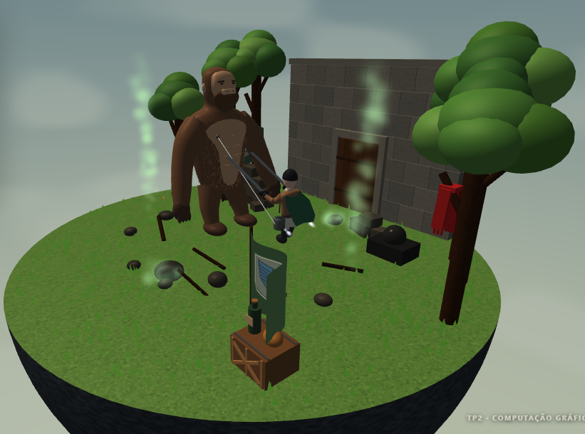
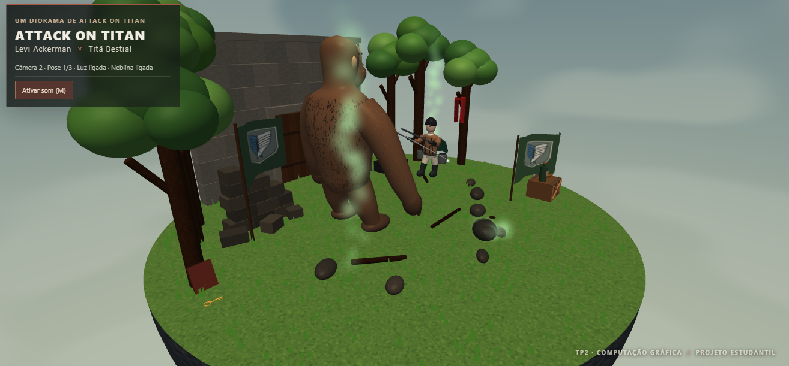
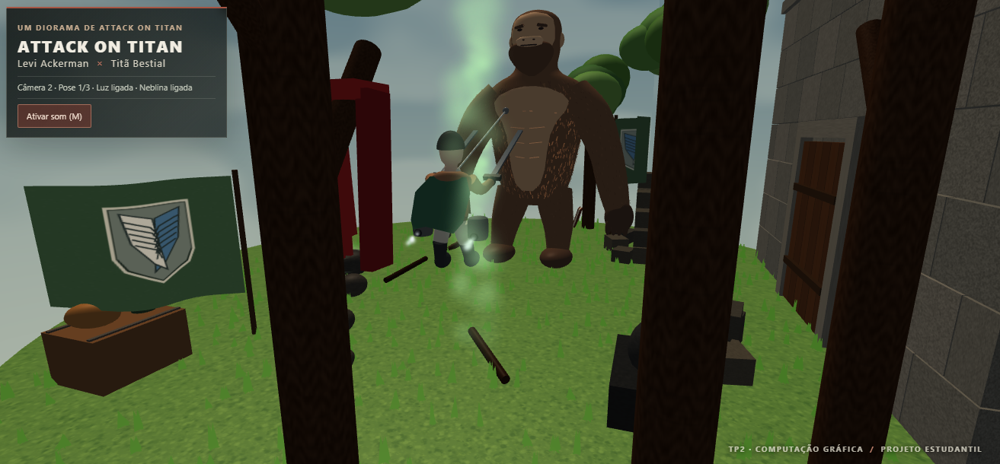

# Attack on Titan — Diorama 3D

## A Cena

Trabalho Prático 2 de Computação Gráfica: um diorama inspirado no confronto entre Levi Ackerman e Zeke Yeager, o Titã Bestial. É um projeto estudantil não oficial.

O projeto usa JavaScript, WebGL 2, shaders GLSL e TWGL.js para auxiliar as operações WebGL. A cena não utiliza THREE.js nem exige instalação de dependências para executar.

## Execução local


```bash
py -m http.server 8000
```

## Cena e controles

A cena inclui uma base circular com gramado e hemisfério inferior, árvores, muralha com portão, ruínas, destroços, vigas, bandeiras com as Asas da Liberdade, canhão articulado e os personagens. A iluminação usa componentes ambiente, difusa e especular; há texturas, céu, neblina, fumaça verde dos sinalizadores, pequenos jatos brancos no equipamento de Levi, som ambiente de vento sintetizado e música de fundo.

Há também referências à história pelo cenário: o diário de Grisha e a chave do porão dos Yeager perto de uma árvore, a batata de Sasha, uma garrafa de vinho e o lenço vermelho de Mikasa pendurado em um galho. Atrás da muralha, uma folha traz a palavra “TATAKAE”.

| Controle | Ação |
| --- | --- |
| `1` | Selecionar câmera automática |
| `2` | Selecionar câmera orbital |
| Arrastar com o botão esquerdo | Girar a câmera orbital |
| Roda do mouse | Aproximar ou afastar |
| `P` | Alternar entre três poses de Levi |
| `L` | Ligar ou desligar a luz |
| `N` | Ligar ou desligar a neblina |
| `M` | Ligar ou desligar a música e o som ambiente |
| `H` | Mostrar ou ocultar a ajuda |

O botão na página também liga ou desliga a música e o vento juntos. A música é reproduzida em repetição e retoma da posição em que foi pausada. O áudio depende de uma interação do usuário e da disponibilidade da Web Audio API no navegador.

## Criadores

- **Kawã Lucca Marques Souza Costa** — [GitHub](https://github.com/Kawalucca).
- **Hugo Daniel Amaral Oliveira** — contato a acrescentar.

## Media Kit



*Visão geral do diorama e dos elementos do cenário.*



*Vista lateral da cena, destacando as bandeiras e a composição do cenário.*



*Detalhe do confronto entre Levi e o Titã Bestial.*

## Opcionais

Itens implementados, conforme o texto do enunciado:

- ⭐ **Modelos tridimensionais**: em vez de usar os
  sólidos próprios ou da TWGL.js, crie ou use modelos tridimensionais de
  terceiros e carregue-os no seu programa. Um formato simples é o `.obj`
  (mas ele não suporta animação). Tem também o formato glTF (mais complexo
  mas suporta animação)
  - Caso queira fazer sobre Pokémon mesmo, [dizem][ripped-pokemon-assets]
    que circulam por aí os modelos 3D de vários monstrinhos de bolso
- ⭐ **_Skybox_, _skyphere_ ou _skydome_**: se considerarmos
  que nosso mundo está definido dentro de um cubo (_skybox_), podemos
  colocar uma imagem de textura em cada face interna (são 6) que
  represente o horizonte naquela direção. Veja
  [exemplos de texturas de _skyboxes_][skybox] e nossa aula sobre
  [efeitos visuais][visual-fx]. Repare que o cubo do _skybox_ acompanha
  a posição, ou seja, não é possível se aproximar de uma parede, muito
  menos sair do cubo
- **Vários tipos de objetos**: em vez de compor o cenário com apenas
  03 tipos de objetos, tenha uns 07 tipos diferentes para dar variedade
- ⭐ **Vento**: simule que existe vento e faça as coisas mexerem com ele.
  Por exemplo, aplique um _shear_ com uma intensidade dada, em um
  certo momento, por uma textura que contém ruído branco
  (eg, _perlin noise_). Moitas de grama e a copa das árvores podem sofrer
  essa transformação
- 🍔 **Efeitos de partículas**:  para simular fenômenos como fogo,
  fumaça, água etc. Falaremos disso na aula de [efeitos visuais][visual-fx]
- 🌟 **Neblina**: funcionalidade acrescentada por comando do
  teclado (<kbd>N</kbd>), podendo ser habilitada e desabilitada
  durante a execução
- 🌟 **Música, efeitos sonoros e/ou som ambiente**: inclua música de fundo,
  sons ambiente e efeitos sonoros (este último, caso haja algum tipo de
  interação)

No diorama, esses itens aparecem como modelos GLB dos personagens, céu procedural, vento nas bandeiras, fumaça, neblina e áudio ambiente com música.

## Modelos e limitações

Os arquivos `assets/models/levi.glb` e `assets/models/zeke.glb` são modelos demonstrativos originais, simplificados e estilizados. Não são modelos oficiais nem foram extraídos do anime. As poses de Levi são feitas por transformações do modelo inteiro, sem animação esquelética.

O carregador próprio implementa um subconjunto de glTF 2.0/GLB 2.0, incluindo hierarquia, malhas triangulares, normais, coordenadas UV e materiais básicos com cor e textura base. Ele não implementa skinning, animações esqueléticas, morph targets, compressão Draco/Meshopt ou o pipeline PBR completo. Modelos externos devem ser exportados como malhas estáticas compatíveis, e seus autores, fontes e licenças devem ser registrados. Consulte [a documentação dos modelos](assets/models/README.md).

## Créditos

- **TWGL.js 5.5.4**, de Gregg Tavares — biblioteca auxiliar WebGL, licença MIT: <https://github.com/greggman/twgl.js>.
- **Música**: “Guren no Yumiya” (Feuerroter Pfeil und Bogen), de Linked Horizon, primeira abertura de *Attack on Titan*. Arquivo fornecido para o projeto: `assets/audio/abertura.mp3`. Referências: [portal oficial de Attack on Titan](https://aot-portal.com/en/music/) e [vídeo da Crunchyroll](https://www.youtube.com/watch?v=8OkpRK2_gVs).
- O som ambiente é sintetizado pela aplicação. Os personagens podem ser gerados com `tools/gerar_personagens.py`, as texturas originais com `tools/gerar_recursos.py`, a do gramado com `tools/gerar_grama.py`, a do brasão com `tools/gerar_brasao.py` e a do bilhete com `tools/gerar_bilhete.py`; a aplicação pronta não precisa das bibliotecas Python usadas para geração.

[ripped-pokemon-assets]: https://models.spriters-resource.com/nintendo_switch/pokemonscarletviolet/
[skybox]: https://www.google.com.br/search?q=skybox&safe=off&hl=pt-BR&source=lnms&tbm=isch&sa=X&ei=jMM_VenRNKuasQSCwYDABw&ved=0CAgQ_AUoAg&biw=1366&bih=599
[visual-fx]: http://fegemo.github.io/utf-cg/classes/visual-effects/#1
